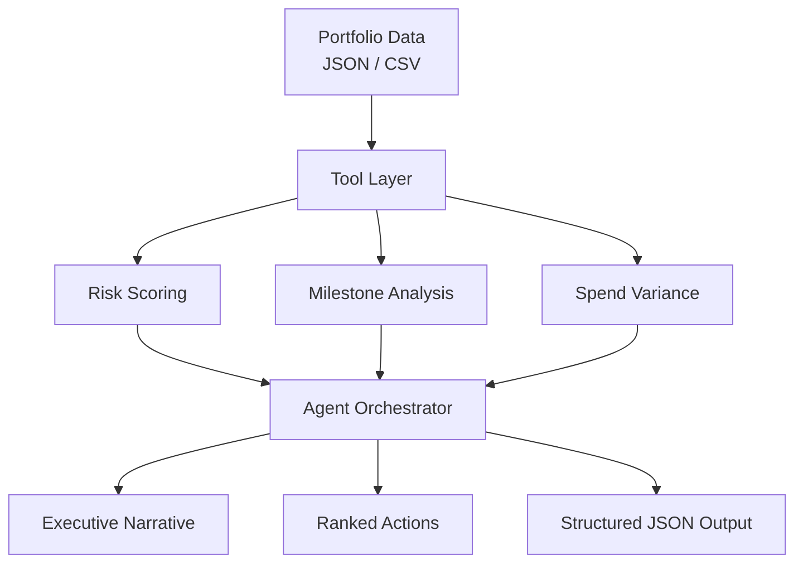

# Portfolio Insight Agent

AI agent that turns infrastructure portfolio data into executive-ready insights: risk rankings, narrative summaries, and recommended actions.

Built to demonstrate practical agentic AI applied to program and operations leadership — the kind of work that sits between data platforms (Power BI/Fabric) and stakeholder decision-making.

## Problem

Program leaders managing multi-billion-dollar infrastructure portfolios (data centers, CapEx, land, leases) spend significant time synthesizing status, spend, risks, and milestones into clear executive updates. Manual synthesis is slow, inconsistent, and hard to scale across dozens of projects.

## What this agent does

Given a portfolio of projects (status, committed spend, risks, milestones, owners), the agent:

1. Ranks projects by risk and impact
2. Generates a concise executive narrative
3. Surfaces the top 3 recommended actions
4. Flags data quality issues or missing information
5. Outputs structured JSON suitable for dashboards or further automation

Runs in **mock mode** (no API key required) or against any OpenAI-compatible endpoint (OpenAI, Azure OpenAI, xAI Grok, local models, etc.).

## Architecture



- Deterministic tools handle scoring and filtering (reproducible, auditable)
- LLM layer synthesizes narrative and recommendations
- Human-in-the-loop by design: agent proposes, leader decides

## Quick start

```bash
git clone https://github.com/lopezar/portfolio-insight-agent
cd portfolio-insight-agent
pip install -r requirements.txt

# Mock mode (no API key)
python agent.py

# Real LLM (any OpenAI-compatible)
export OPENAI_API_KEY=your_key
export OPENAI_BASE_URL=https://api.x.ai/v1   # or Azure, OpenAI, local, etc.
python agent.py --live
```

## Sample output (mock mode)

See `sample_output.md` for a full example.

## Design choices

- **Tools over pure prompting**: Risk scoring and variance calculations are deterministic so results are consistent and explainable.
- **Provider-agnostic**: Works with Grok, Claude (via compatible proxy), GPT, or local models.
- **No real data**: All portfolio data is synthetic. Designed so you can swap in your own sanitized extracts.
- **Evaluation-ready**: Structured output makes it straightforward to add golden-set checks or human review loops.

## Limitations

- Mock mode uses rule-based narrative (good for demos, not generative quality).
- Does not connect to live data sources (by design — keeps the demo safe and reproducible).
- Single-agent for clarity; multi-agent extensions are straightforward.

## Next steps

- Add Power BI / Fabric export integration
- Human approval gate before actions are suggested as "ready"
- Cost and latency tracking
- Multi-agent variant (data quality agent + narrative agent + risk agent)

## License

MIT
